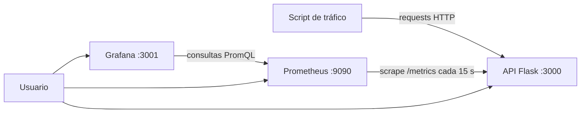

# Monitoreo y observabilidad de una API con Prometheus y Grafana

Actividad BONUS – Desarrollo de aplicaciones en la nube
Fundación Universitaria Los Libertadores

| | |
|---|---|
| **Nombre** | Brayan Madera |
| **Código de estudiante** | [202220042601] |
| **Repositorio** | https://github.com/bdmaderam/monitoreo-api |
| **Video** | https://fundacionlibertadores-my.sharepoint.com/:v:/r/personal/bdmaderam_libertadores_edu_co/_layouts/15/stream.aspx?id=%2Fpersonal%2Fbdmaderam_libertadores_edu_co%2FDocuments%2FVideo%20Project.mp4&nav=eyJyZWZlcnJhbEluZm8iOnsicmVmZXJyYWxBcHAiOiJPbmVEcml2ZUZvckJ1c2luZXNzIiwicmVmZXJyYWxBcHBQbGF0Zm9ybSI6IldlYiIsInJlZmVycmFsTW9kZSI6InZpZXciLCJyZWZlcnJhbFZpZXciOiJNeUZpbGVzTGlua0NvcHkifX0&share=cQpVOAuhmFYCQ51X8GOROCYREgUCxN_yeGpKUUujZ7zlpZLu3Q


---

## 1. Descripción

Este proyecto es un sistema de monitoreo completo para una API REST propia, ejecutado con `docker-compose`:

- Una **API en Python (Flask)** con 8 endpoints, instrumentada para exponer métricas en formato Prometheus.
- **Prometheus**, que consulta la API cada 15 segundos y guarda las métricas.
- **Grafana**, que muestra las métricas en un dashboard que se carga automáticamente.
- Un **script de tráfico sintético** que simula usuarios para que las gráficas tengan datos.

La API no tiene lógica de negocio real. Sus endpoints están hechos a propósito para comportarse distinto (rápido, lento, con errores, con uso de CPU) y así poder observar esas diferencias en las métricas.

## 2. Arquitectura



Los tres servicios corren en la misma red de Docker (`monitoring`), por eso Prometheus encuentra la API con el nombre `api:3000` y Grafana encuentra a Prometheus con `prometheus:9090`.

## 3. Estructura del proyecto

```
.
├── docker-compose.yml
├── README.md
├── api/
│   ├── Dockerfile
│   ├── requirements.txt
│   └── app.py                    # API y métricas
├── prometheus/
│   ├── prometheus.yml            # configuración del scraping
│   └── alerts.yml                # reglas de alerta
├── grafana/
│   ├── provisioning/
│   │   ├── datasources/prometheus.yml
│   │   └── dashboards/dashboards.yml
│   └── dashboards/api-monitoreo.json
└── scripts/
    ├── generate-traffic.py       # tráfico sintético (Python)
    └── generate-traffic.sh       # tráfico sintético (Bash + curl)
```

## 4. Requisitos previos

- Docker Desktop (o Docker Engine) y Docker Compose, con Docker en ejecución.
- Python 3 para el script de tráfico (opcional, también hay versión en Bash).
- Puertos libres en el equipo: **3000**, **3001** y **9090**.

## 5. Cómo ejecutarlo

Desde la carpeta que contiene el `docker-compose.yml`:

```bash
# 1. Limpiar cualquier ejecución anterior
docker-compose down -v

# 2. Construir y levantar los 3 servicios
docker-compose up -d --build

# 3. Verificar que los 3 estén en estado Up
docker-compose ps
```

Si `docker-compose` no se reconoce, usar `docker compose` (con espacio).

### Accesos

| Servicio | URL | Credenciales |
|---|---|---|
| API | http://localhost:3000 | - |
| Métricas de la API | http://localhost:3000/metrics | - |
| Prometheus | http://localhost:9090 | - |
| Grafana | http://localhost:3001 | admin / admin |

En Grafana, el dashboard está en **Dashboards → Monitoreo API**. No hay que importar nada: se carga solo mediante *provisioning*.

### Verificación rápida

1. `docker-compose ps` muestra `api`, `prometheus` y `grafana` en estado Up.
2. http://localhost:3000/health responde `{"status":"ok"}`.
3. http://localhost:9090/targets muestra el job `mi-api` en **UP** (puede tardar unos 15 segundos).
4. En Grafana se ve el dashboard Monitoreo API.

### Generar tráfico

Con las gráficas vacías no hay nada que ver. En otra terminal:

```bash
# Python (solo librería estándar): URL y duración en segundos
python scripts/generate-traffic.py http://localhost:3000 900

# Bash con curl
./scripts/generate-traffic.sh http://localhost:3000 900
```

En Windows, si `python` no funciona, usar `py`. Para detener el script: `Ctrl + C`.

El script lanza 6 hilos que escogen rutas al azar con distinto peso: la mayoría va a `/api/datos`, y una parte va a `/api/lento`, `/api/error`, `/api/calculo`, `/api/items` y a una ruta inexistente (para generar 404).

### Apagar

```bash
docker-compose down       # detiene y conserva los datos
docker-compose down -v    # detiene y borra los volúmenes
```

## 6. API

| Endpoint | Método | Descripción |
|---|---|---|
| `/` | GET | Información de la API y lista de rutas |
| `/api/datos` | GET | Temperatura y humedad simuladas, respuesta rápida |
| `/api/lento` | GET | Simula procesamiento lento (2 a 3 segundos) |
| `/api/error` | GET | Falla con error 500 en ~30% de los casos (variable `ERROR_RATE`) |
| `/api/items` | GET / POST | Lista los items o crea uno nuevo (en memoria) |
| `/api/calculo/<n>` | GET | Cálculo que consume CPU, `n` máximo 200000 |
| `/health` | GET | Estado de la API |
| `/metrics` | GET | Métricas en formato Prometheus |

Ejemplos:

```bash
curl http://localhost:3000/api/datos
curl -X POST http://localhost:3000/api/items
```

En PowerShell, usar `curl.exe` en lugar de `curl`.

## 7. Métricas expuestas

| Métrica | Tipo | Etiquetas | Qué mide |
|---|---|---|---|
| `http_requests_total` | Counter | method, endpoint, status | Total de requests. Base para throughput y errores |
| `http_request_duration_seconds` | Histogram | method, endpoint | Latencia. Permite promedio, p95 y p99 |
| `http_requests_in_progress` | Gauge | endpoint | Requests que se están atendiendo en este momento |
| `system_cpu_percent` | Gauge | - | Uso de CPU del sistema |
| `system_memory_percent` | Gauge | - | Uso de memoria del sistema |
| `api_process_memory_bytes` | Gauge | - | Memoria que usa el proceso de la API |
| `api_items_creados_total` | Counter | - | Métrica personalizada: items creados |
| `process_*`, `python_gc_*` | Varios | - | Métricas por defecto de `prometheus-client` |

Los buckets del histograma van de 5 ms a 5 s: `0.005, 0.01, 0.025, 0.05, 0.1, 0.25, 0.5, 1, 2, 2.5, 3, 5`.

### Cómo se instrumenta

En `api/app.py` dos funciones se ejecutan en cada request:

- `before_request`: inicia un cronómetro y sube el gauge de requests activos.
- `after_request`: incrementa el contador con el método, la ruta y el código de estado; registra la duración en el histograma; baja el gauge; y escribe una línea de log.

Así todos los endpoints quedan medidos sin repetir código. El endpoint `/metrics` no se cuenta a sí mismo.

## 8. Prometheus

Archivo: `prometheus/prometheus.yml`

```yaml
global:
  scrape_interval: 15s
  evaluation_interval: 15s

rule_files:
  - /etc/prometheus/alerts.yml

scrape_configs:
  - job_name: 'mi-api'
    metrics_path: /metrics
    static_configs:
      - targets: ['api:3000']
  - job_name: 'prometheus'
    static_configs:
      - targets: ['localhost:9090']
```

### Consultas PromQL útiles

```promql
# Requests por segundo por endpoint
sum by (endpoint) (rate(http_requests_total[1m]))

# Latencia promedio
sum(rate(http_request_duration_seconds_sum[1m])) / sum(rate(http_request_duration_seconds_count[1m]))

# Latencia p95
histogram_quantile(0.95, sum by (le) (rate(http_request_duration_seconds_bucket[1m])))

# Latencia p95 por endpoint
histogram_quantile(0.95, sum by (le, endpoint) (rate(http_request_duration_seconds_bucket[1m])))

# Porcentaje de errores 5xx
100 * sum(rate(http_requests_total{status=~"5.."}[1m])) / sum(rate(http_requests_total[1m]))

# Requests por código de estado
sum by (status) (rate(http_requests_total[1m]))

# Requests activos
sum(http_requests_in_progress)
```

## 9. Alertas

Definidas en `prometheus/alerts.yml`, visibles en http://localhost:9090/alerts.

| Alerta | Condición | Duración | Severidad |
|---|---|---|---|
| `APICaida` | `up{job="mi-api"} == 0` | 30 s | critical |
| `TasaErroresAlta` | más de 20% de respuestas 5xx | 1 min | warning |
| `LatenciaP95Alta` | p95 mayor a 2 s | 1 min | warning |

Para probar `APICaida`:

```bash
docker-compose stop api     # esperar ~1 minuto y mirar /alerts
docker-compose start api
```

## 10. Dashboard de Grafana

El datasource y el dashboard se cargan desde `grafana/provisioning` y `grafana/dashboards`. El dashboard **Monitoreo API** tiene 11 paneles y se actualiza cada 5 segundos.

| Panel | Qué muestra |
|---|---|
| Requests totales | Total acumulado de requests |
| Throughput actual | Requests por segundo en este momento |
| Tasa de errores 5xx | Porcentaje de fallas, con colores: verde, naranja (10%) y rojo (20%) |
| Requests activos | Requests en proceso ahora |
| Throughput por endpoint | Requests por segundo de cada ruta |
| Latencia: promedio, p95 y p99 | Tiempo de respuesta en tres líneas |
| Latencia p95 por endpoint | Qué ruta es la más lenta |
| Requests por código de estado | Proporción de 200, 404, 500, etc. |
| Requests activos por endpoint | Carga concurrente por ruta |
| Memoria | Memoria del proceso de la API |
| CPU y memoria del sistema | Uso de recursos del equipo |

## 11. Logging

Cada request genera una línea JSON en la salida estándar de la API:

```json
{"ts": "2026-10-24T15:30:12", "method": "GET", "endpoint": "/api/datos", "status": 200, "duration_ms": 1.37}
```

Para verlos:

```bash
docker-compose logs -f api
docker-compose logs --tail 10 api
```

## 12. Decisiones técnicas

- **Gunicorn con 1 worker y 8 hilos.** `prometheus-client` guarda las métricas en la memoria del proceso. Con varios workers cada uno tendría contadores distintos y los números saldrían incompletos.
- **La etiqueta `endpoint` usa la ruta definida** (por ejemplo `/api/calculo/<int:n>`) y no la URL real. Así no se crea una serie nueva por cada valor de `n` y se evita una cardinalidad alta.
- **Histograma en lugar de solo promedio.** El promedio oculta las peticiones lentas; con los buckets se pueden calcular p95 y p99.
- **Dashboard y datasource por provisioning.** El proyecto funciona al primer `docker-compose up` sin pasos manuales en Grafana.

## 13. Cumplimiento de los requisitos de la actividad

| Requisito | Dónde está |
|---|---|
| API con al menos 3 endpoints | 8 endpoints, sección 6 |
| Endpoint `/metrics` | `GET /metrics` |
| Contador de requests por endpoint | `http_requests_total` |
| Latencia | `http_request_duration_seconds` (histograma) |
| Requests activos (gauge) | `http_requests_in_progress` |
| Métricas de sistema (CPU, memoria) | `system_cpu_percent`, `system_memory_percent`, `api_process_memory_bytes` |
| Prometheus con scraping cada 15 s | `prometheus/prometheus.yml` |
| Dashboard con 3 o más paneles (throughput, latencia, adicional) | 11 paneles, sección 10 |
| Script de tráfico sintético | `scripts/generate-traffic.py` y `.sh` |
| Todo en Docker con `docker-compose` | `docker-compose.yml` |
| README con instrucciones | Este archivo |

Puntos bonus implementados: alertas en Prometheus, más de 5 endpoints, dashboard con 11 paneles, logging estructurado, histogramas y percentiles, y README documentado.

## 14. Solución de problemas

| Problema | Qué hacer |
|---|---|
| `no configuration file provided: not found` | Estás en la carpeta equivocada. Entra a la que tiene el `docker-compose.yml` |
| `port is already allocated` | Otro programa usa el 3000, 3001 o 9090. Ciérralo o cambia el puerto de la izquierda en el `docker-compose.yml` |
| Docker no responde | Abrir Docker Desktop y esperar a que diga que el motor está corriendo |
| Paneles vacíos en Grafana | No hay tráfico: ejecutar el script. Revisar que el rango de tiempo sea "Last 15 minutes" |
| Prometheus muestra la API en DOWN | Revisar `docker-compose ps` y `docker-compose logs api` |
| `curl -X POST` falla en PowerShell | Usar `curl.exe` |
